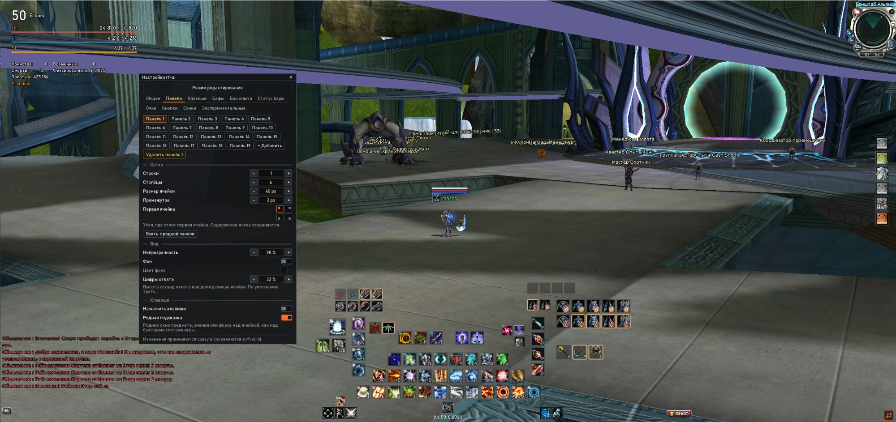
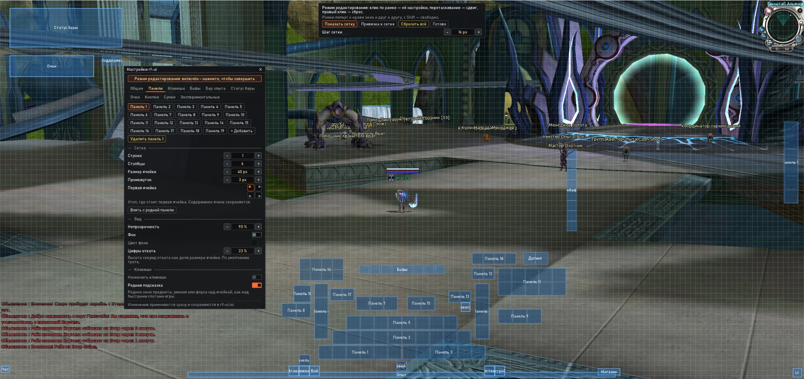
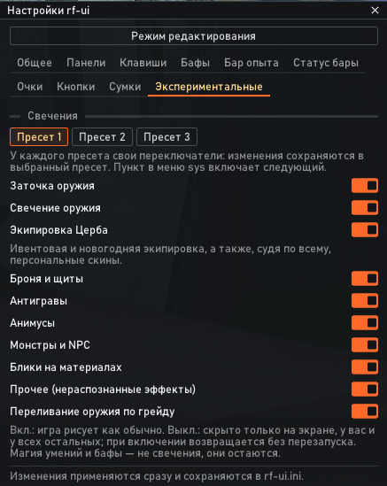
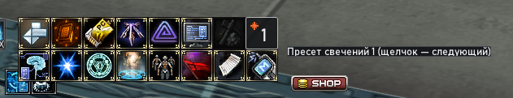
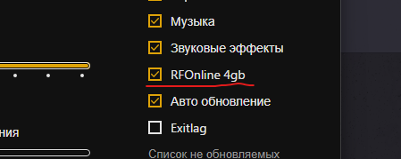

# rf-ui

Downloads: [latest release](../../releases/latest)

[Русский](#русский) · [English](#english)

---

## Русский

### Что это
Небольшая DLL (`dinput8.dll`), которая кладётся в папку клиента и добавляет гибкую настройку интерфейса: свои панели быстрых слотов, перенос баффов, свой HUD статуса, кнопки, оптимизацию свечений. Всё настраивается прямо в игре. Конфиги хранятся локально в папке с клиентом.

* Только интерфейс. Сеть, пакеты и игровые механики не трогаются.
* Единственная автоматизация - квик каст прямо с панели.
* Безопасный отказ: если клиент другой версии, мод сам отключается, пишет причину в лог, клиент запускается без проблем.
* Родной интерфейс не ломается: кнопкой в углу можно в любой момент вернуться к стандартному.

### Функционал интерфейса

* До 30 панелей, у каждой свои строки × столбцы, размер ячейки, отступ, прозрачность, фон, позиция.
* Сами ячейки повторяют функционал оригинальных, каждую ячейку можно назначить за своей кнопкой, либо комбинацией.
* Назначенные клавиши новых ячеек не конфликтуют с стандартной раскладкой панели и раскладкой биндов церба, при переключении на классический интерфейс работают они.
* Кончилась расходка - ячейка серая, но содержимое не теряется, когда предмет появится в инвентаре он станет доступен с панели.
* При заходе нового персонажа сразу появляется панель 5×10, на неё один раз раскладывается ваша родная панель быстрых слотов. Родную панель мод скрывает. Так же можно скопировать оригинальную панель кнопкой в настройках.
* Автокаст - кликом Ctrl + ПКМ включает автоматическое применение макроса (альтернатива RfUfree). Автоматически выключается при релоге и выходе.
* Смена позиции и настройка отображения бафов, дебафов, рас бафа, поддержки и допингов.
* Режим редактирования - можно перетащить все элементы нового UI, прижать к соседям, выровнять по сетке или поставить в произвольное место зажав Shift.

* Режим клавиатуры сам включается при входе.
* Можно скрыть панель "Ресурс руды".
* Эскпорт и импорт настроек, несколько цветовых схем, русский и английский язык.

### Функционал антилага

* Добавлена возможность отключать и включать обратно конкретные типы свечения прямо в игре.
* Добавлена возможность сделать три пресета свечения.
* В меню добавлена кнопка цикличного переключения пресетов.

### Установка

1. Закройте игру и лаунчер.
2. Скопируйте `dinput8.dll` в папку клиента, туда, где лежит `RF_Online_4gb.bin`.
3. В настройках лаунчера включите RFOnline 4gb - без него работать не будет (пока что).

4. Запустите игру как обычно через лаунчер.
5. После входа в мир в правом нижнем углу появится маленькая кнопка 28×28 px. В папке клиента появятся `rf-ui.log` и, после первой настройки, `rf-ui.ini`.
6. Удаление: закройте игру и удалите `dinput8.dll` (а также `rf-ui.ini` и `rf-ui.log`, если не нужны настройки).

Если в `rf-ui.log` написано, что клиент неизвестен и функции отключены, значит у вас другая версия клиента: мод ничего не делает, игра работает штатно.

---

## English

### What it is
A small DLL (`dinput8.dll`) that goes into the client folder and adds flexible interface customization: custom quick-slot panels, relocatable buffs, a custom status HUD, buttons, and glow optimization. Everything is configured right in the game. Configs are stored locally in the client folder.

* Interface only. The network, packets and game mechanics are not touched.
* The only automation is quick cast right from the panel.
* Fail-safe: if the client is a different version, the mod disables itself, writes the reason to the log, and the client starts without any problems.
* The native interface is not broken: you can switch back to the standard one at any time with the button in the corner.

### Interface features

* Up to 30 panels, each with its own rows × columns, cell size, spacing, transparency, background and position.
* The cells repeat the functionality of the original ones; each cell can be bound to its own key or a key combination.
* Keys assigned to the new cells don’t conflict with the standard panel layout or the Cerberus keybind layout; when you switch to the classic interface, the native ones work.
* Out of consumables - the cell turns gray, but its content is not lost; when the item appears in your inventory, it becomes available from the panel again.
* When a new character logs in, a 5×10 panel appears right away, and your native quick-slot panel is laid out onto it once. The mod hides the native panel. You can also copy the original panel with a button in the settings.
* Autocast - Ctrl + RMB enables automatic use of a macro (an alternative to RfUfree). It is turned off automatically on relog and on exit.
* Change the position and display settings of buffs, debuffs, race buff, support and doping.
* Edit mode - you can drag all elements of the new UI, snap them to neighbors, align them to a grid, or place them anywhere by holding Shift.
* Keyboard mode turns on by itself on login.
* You can hide the “Ore resources” panel.
* Settings export and import, several color schemes, Russian and English languages.

### Anti-lag features

* Added the ability to turn specific glow types off and back on right in the game.
* Added the ability to make three glow presets.
* Added a menu button that cycles through the presets.

### Installation

1. Close the game and the launcher.
2. Copy `dinput8.dll` into the client folder, where `RF_Online_4gb.bin` is located.
3. In the launcher settings, enable RFOnline 4gb - it won’t work without it (for now).
4. Start the game as usual through the launcher.
5. After entering the world, a small 28×28 px button will appear in the bottom-right corner. `rf-ui.log` will appear in the client folder, and `rf-ui.ini` will appear after the first setup.
6. Uninstall: close the game and delete `dinput8.dll` (and also `rf-ui.ini` and `rf-ui.log` if you don’t need the settings).

If `rf-ui.log` says that the client is unknown and the features are disabled, it means you have a different client version: the mod does nothing and the game runs normally.

## License

[PolyForm Noncommercial 1.0.0](LICENSE): free to use and redistribute for noncommercial purposes; commercial use requires the author's permission. Third-party libraries (Dear ImGui, MinHook) are under their own licenses, see `LICENSES.txt` in the archive.
